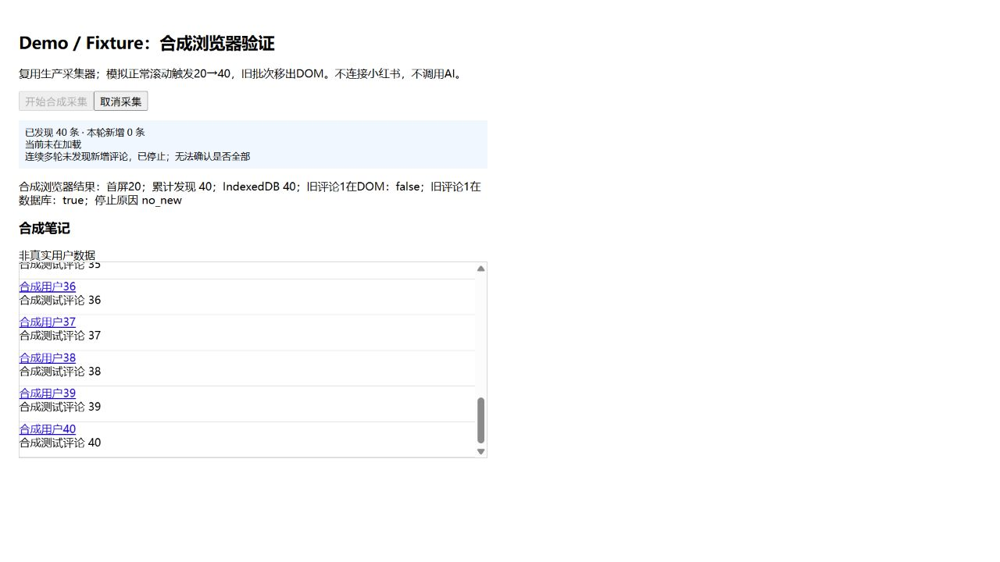

# 评论增量采集修复（2026-10-16）

起始基线：`codex/eric-development` / `0148c38`，工作区干净。用户本轮明确授权当前笔记内正常滚动，覆盖旧文档的禁止自动滚动条款，其他安全与分析边界不变。

## 改动与原因

旧实现的Session有内存缓冲，但captureNote取完首次分页即STOP；不会触发懒加载，500ms观察延迟也可能漏过虚拟列表临时项。

现有生命周期保持 STATUS→START→分页/采集→STOP。后台NOTE_ANALYZE显式开启增量模式：首屏去重并事务保存后，GET_SNAPSHOT的可选advance让content script仅对当前笔记内、容纳已确认评论列表的可滚动祖先小步scrollBy。之后每500ms取样并把新增条目落库，5次取样为一轮，再继续滚动。观察器在微任务中立即提取到会话缓冲；DOM移除不会删除内存或IndexedDB记录。不是最后滚到底部才query。

平台评论ID继续用于强身份去重；作者/时间等现有弱哈希保持。同一无ID节点反复取样复用保守序号，不因轮询膨胀。若无任何可靠身份且被全新DOM重建，无法证明是重复还是不同作者的相同短评论，仍保守标weak，不宣称完美去重。

每轮新增通过saveCaptureDelta在jobs/notes/comments事务中检查collecting和取消信号后保存。取消立即abort等待、发送STOP；取消已确认的任务拒绝迟到写入，已保存数据保留。采集失败不启动AI分析，不将已有评论删掉。AI仍在采集正常停止后按既有批次/缓存执行，没有修改Prompt、分组、模型或缓存键。

Job增加可选collection字段，无索引或数据库版本迁移；UI通过原有JOB_GET轮询显示已发现、本轮新增、是否加载中、停止原因。旧记录兼容。按钮为“开始采集评论（完成后分析）”。

## 停止条件与诚实边界

| 条件 | 行为与显示 |
|---|---|
| 连续4轮未新增，每轮5×500ms取样 | no_new，通常至少等待约10秒（不含请求/落库耗时）；不声称全部 |
| 已收集500条 | limit，停止继续滚动，保留500条 |
| 3分钟或200轮上限 | time_limit/round_limit，明确未确认全部 |
| 已有fixture证实的暂无评论标记 | no_more，仅指页面显示暂无评论 |
| 用户取消 | cancelled，STOP并停止写入；此前落库保留 |
| 登录遮挡、换帖、解析失败、未知滚动容器、存储失败 | 明确错误；停止且保留已保存评论；不继续模型调用 |
| 页面消息不返回 | 10秒请求超时；等待快照时可被取消打断 |

不自动展开折叠子回复、不进入其他笔记、不触发任何社交互动、不读Cookie/密码、不调用平台私有API、不绕验证码。观察到登录遮挡会报告平台限制；验证码DOM尚无完整真实fixture，不能宣称所有风控遮挡均可识别。无新增也可能是平台限制或网络过慢，结果始终标未确认全部。

## 测试证据

`tests/integration/xhs-incremental.test.ts`使用明确合成DOM与真实Session/协议/captureNote/Repositories/fake-indexeddb，滚动几何与后续DOM由测试模拟，不是真实小红书。

- A–E：首屏20；滚动后21–40；1–20移出DOM；IndexedDB仍有1–40；重复页不重复保存，首次滚动前首屏已落库。
- F：连续多轮无新增才停止；第三轮才到的新评论仍纳入。
- G：等待取消发送STOP；后续DOM不再写入；取消已落库任务拒绝迟到checkpoint。
- H：第24次滚动累计500条后立即停止，不再继续滚动。
- I：容器消失报错并STOP，首屏保留；覆盖平台登录限制、换帖、存储失败、未知容器。
- 额外：同一弱身份DOM重复取样、明确空评论、实时进度、评论不足一屏。
- `xhs-capture.test.ts`新增快照消息不返回时取消及10秒请求超时。
- `collection-progress.test.ts`验证加载状态和未确认全量文案；保留既有分页、缓存、批次、隐私与分析回归。

## 合成浏览器验证（不是真实小红书）

内置浏览器在localhost运行生产XhsSessionManager/captureNote/CollectionProgress，替换的仅为扩展消息桥；滚动使用真实HTMLElement.scrollBy，延迟250ms替换为下一批DOM，本地实际IndexedDB。只点击一次“开始合成采集”，无手动滚动。

观察结果：首屏20→累计发现40→IndexedDB40；旧评论1在DOM=false、在数据库=true；最终no_new，显示“无法确认是否全部”。截图如下。临时标签与本轮本地预览进程已关闭。此证据不证明Edge扩展加载、真实小红书DOM、平台限制或AI效果通过。

最终验证：typecheck/lint/build通过；全量24文件/235项通过（新增19项），Edge ZIP已生成（350,917 B）并核对包内运行文件与构建目录一致。详见test-report.md第7节。真实小红书仍为NOT VERIFIED。

## 下一步真实小红书验收（尚未执行）

1. 更新原有Edge扩展到本轮ZIP并重新加载，保留原扩展数据；不要为了更新先移除扩展。刷新小红书标签页，避免仍运行旧content script。
2. 用户自行在扩展内配置Key、选中产品，打开评论较多的真实笔记；记录首屏已加载数量与前几条评论，避免包含Key截图。
3. 点击“开始采集评论（完成后分析）”，不手动滚动助载；目标笔记保持打开，观察自动滚动、已发现/新增数和最终停止原因。
4. 验证累计数明显超过首屏；首屏评论移出DOM后仍在本地结果/导出，稳定ID无重复；“未新增”不能称全部。
5. 中途取消一次，确认页面不再继续滚动、评论数不再增加，已保存首屏保留；正常完成后核对原有分析/缓存仍可用。
6. 出现验证码/登录/评论权限限制时记录“平台限制”，停止并由用户手动处理；未知容器记录解析失败。不要绕过，不把停止前已获取数量冒充全量。
