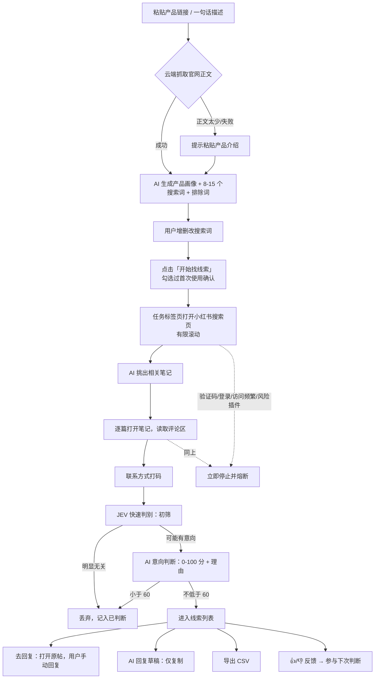

# 觅客Agent（SeekLead Agent）产品需求文档 PRD

> 版本：v1.0 草案，2026-10-15（北京时间）
> 依据：`极简插件方案.md`（v3）、`开发计划-v1-小红书.md`（v2.0）、`插件类竞品调研与插件方案.md`、`国内版Ownfeed调研与MVP方案.md` 合规章节。
> 写法约定：文中的数字都来自以上文件。没有依据的写「待定」，JEV 的具体做法写「待作者补充」。额度和频率上限都是**初始猜测**，内测时只能往下调。

---

## 1. 产品概述

**一句话定位：** 一个只读的浏览器插件，帮你从小红书评论区里找到想买你东西的人。

**简介：**
觅客Agent 是一个获客插件，帮你从评论区里找客户。贴上你的产品链接，它会先弄清你卖的是什么，生成一组搜索词，到你登录的小红书网页版里翻相关笔记和评论。评论先用 JEV 快速判别筛一遍，再由 AI 打意向分，把问「哪里买」「求推荐」的人挑出来。每条线索都附上评论原文、意向分、判断理由和评论者主页，你点进去自己回复就行。插件只读不写：不替你发私信，也不碰你的账号密码。第一版先支持小红书，抖音等平台后续接入。

**产品形态：**
- 浏览器插件：Chrome / Edge，MV3，WXT + React + TypeScript，侧边栏界面。
- 轻后端：一台国内轻量云，Node（Hono）+ SQLite，前面用 Caddy 做 HTTPS。负责激活码授权、额度计数、AI 代理（DeepSeek）、解析配置下发、匿名计数。**后端不访问小红书，不保存产品、线索或评论内容。**

---

## 2. 目标用户与场景

**目标用户：** 有明确产品、想在小红书上找客户的个人和小商家（与内测用户画像一致，见开发计划 P10）。

| 场景 | 说明 |
|---|---|
| 新品找第一批用户 | 贴官网或写一句话介绍，看看小红书上谁在找这类东西 |
| 日常获客 | 每天手动跑一次，只看新出现的线索，挑着去回复 |
| 了解需求 | 看 AI 给出的需求摘要和理由，知道大家在问什么、吐槽什么 |

**不服务的用法：** 批量私信、骚扰、电话或短信营销、名单买卖、多账号矩阵、云端代跑。

---

## 3. 竞品与差异

| | Ownfeed | MediaClaw「评论区截流」 | 红薯养号器 | 觅客Agent v1 |
|---|---|---|---|---|
| 入口 | 产品网址 → AI 找帖子 | 先采集评论，再按关键词或 IP 过滤 | 自动浏览/点赞/评论 | 产品链接或描述 → 画像 → 搜索词 → 读评论 → JEV 初筛 → AI 打分 |
| 平台 | Reddit、X、Bluesky、HN | 小红书、抖音 | 小红书 | 小红书 |
| 运行位置 | 云端 | 用户浏览器插件 | 用户浏览器插件 | 用户浏览器插件 |
| 回复 | 用户自己写 | 有自动私信（默认 24 小时 100 条） | Pro 自动评论 | 只打开原帖 + 草稿复制，**不自动发送** |
| 用户信息 | 发帖人 | 昵称、主页链接、IP 属地 | — | 昵称、主页链接；**不做 IP 属地**（待定）；联系方式打码 |
| 收费 | $39/月，自动续费 | 个人版 ¥59/30 天、¥99/90 天、¥299/365 天；¥9 全能卡 5 天；一次买断 | Pro US$12/月，自动续订 | 见第 10 节，一次买断 |

**差异点：**
1. 从「你卖什么」出发，不需要用户自己想关键词。
2. 判断的是「意向」，每条线索带分数和理由，不是一堆原始评论。
3. 只读，不做任何自动互动，账号风险和法律风险都更低。

---

## 4. 功能需求

优先级：P0 = v1 必须；P1 = v1 要做但可在压缩工期时简化；P2 = v2 及以后。

### 4.1 功能清单

| 编号 | 功能 | 优先级 | 免费/付费 |
|---|---|---|---|
| F1 | 产品管理（链接抓取 / 粘贴介绍 → 画像 + 搜索词，可编辑，多产品） | P0 | 均可，数量受限 |
| F2 | 找线索运行（搜索 → AI 挑笔记 → 读评论 → JEV 初筛 → AI 意向判断；进度、暂停、停止；去重） | P0 | 均可，额度受限 |
| F3 | 线索列表（新线索/全部/已处理；排序筛选；去回复、已处理、👍/👎） | P0 | 均可，免费版第 11 条起遮挡 |
| F4 | AI 回复草稿（只复制） | P0 | 付费 |
| F5 | 导出 CSV | P0 | 付费 |
| F6 | 联系方式打码、首次使用确认、导出提醒、一键清空、到期清理 | P0 | 均可 |
| F7 | 风控探测、频率上限、熔断 | P0 | 均可 |
| F8 | 激活码授权、设备绑定、额度 | P0 | — |
| F9 | 反馈调优（👍/👎 样本参与下次判断） | P1（压缩工期时只记录不参与） | 均可 |
| F10 | 解析配置云端下发 | P1（压缩工期时移到 v2） | — |
| F11 | 匿名计数上报 | P1 | — |
| F12 | 抖音、飞书多维表格同步、采集当前页、AI 选题、搜索词自动调优、运行提醒、IP 属地筛选（可选）、支付自动化、团队版 | P2 | — |

### 4.2 用户故事与验收标准

**F1 产品管理**
- 用户故事：作为卖家，我贴上产品链接，就能得到产品画像和一组搜索词，并能自己改。
- 验收：
  - 普通官网能抓到正文；纯前端渲染的网站返回「正文太少」，引导粘贴介绍。
  - 画像包含：卖什么、目标人群、痛点、使用场景、不适合谁；搜索词 8–15 个，另有排除词；都可增删改。
  - 内网地址和小红书等平台域名被拒绝抓取。
  - 用户对画像和搜索词评分（1–5 分），平均 ≥3.5。
  - 产品只存在本地。

**F2 找线索运行**
- 用户故事：我点「开始找线索」，插件在一个任务标签页里自己搜、自己翻，我看着进度，随时能停。
- 验收：
  - 只能手动开始；全局单任务；任务标签页切到后台自动暂停。
  - 每个搜索页滚动 ≤2 屏、≤20 篇；每篇笔记评论滚动 ≤3 屏、≤60 条；不点「展开更多回复」。
  - 动作间隔在设定范围内；到达每日上限后停止。
  - 去重：3 天内看过的笔记默认不再打开，判断过的评论不再送 AI；同一产品连续跑 2 次不产生重复线索。

**F3 线索列表**
- 用户故事：我能看到按意向分排好的线索，点「去回复」直接到原帖。
- 验收：
  - 每条显示：评论原文（已打码）、所属笔记标题和链接、评论者昵称和主页链接、时间、意向分、类型、理由、需求摘要、建议切入点。
  - 「去回复」只打开原帖；已处理、👍/👎 持久保存。
  - 免费版第 11 条起：原文模糊、昵称只显示首字、主页链接隐藏，且 DOM 中没有完整原文。

**F4 AI 回复草稿**
- 用户故事：我不知道怎么开口时，让 AI 给我写 1–2 条草稿，我复制后自己去发。
- 验收：草稿不含联系方式、网址或绝对化用语；只能复制，没有任何把草稿送进页面的代码；免费版锁定（可看一条示例）。

**F5 导出 CSV**
- 验收：字段与 7.4 一致；文件首行写个人信息提醒；每次导出前确认（可勾选本次会话不再提示）；不乱码；公式注入被转义；免费版锁定。

**F6 个人信息处理**
- 验收：手机号、微信号、QQ、邮箱、身份证号在入库、显示、导出、AI 请求体中都已打码，不可关闭；AI 请求体中没有昵称和主页链接；免费 14 天、付费 90 天自动清理；可一键清空。

**F7 风控**
- 验收：出现验证码、登录、访问频繁、风险插件提示时 ≤1 秒停止且不重试；7 天内 2 次触发进入 72 小时冷却。

**F8 授权**
- 验收：激活码输入 → 绑定本机 → 每 24 小时校验，离线宽限 72 小时；每月可自助换绑 2 次；续费合并、吊销正常。

---

## 5. 核心流程

---

## 6. 页面与交互说明

侧边栏五个页面：**产品 │ 运行 │ 线索 │ 账户 │ 设置**。

| 页面 | 主要内容 | 交互要点 |
|---|---|---|
| 首次打开 | 用户协议要点、隐私说明、账号风险告知 | 必须勾选「我已阅读用户协议，承诺合法使用、不批量骚扰、不交易名单」和「我了解批量浏览可能导致账号受限，风险由我承担，建议使用非主力账号」才能运行 |
| 产品 | 产品列表；新建/编辑：链接或介绍、画像、搜索词、排除词 | 抓取失败时提示粘贴；超过产品数上限时显示升级提示 |
| 运行 | 选择产品和搜索词；进度（搜索、看到/打开的笔记、读取评论、判断数、新线索数）；今日余量；熔断状态 | 开始 / 暂停 / 停止；熔断横幅：「小红书出现了{验证/登录/访问频繁/风险插件}提示，已停止。请在网页上自行处理，24 小时内不要再运行。」 |
| 线索 | 新线索 / 全部 / 已处理；按意向分、时间排序；按类型筛选 | 每条：去回复、已处理、👍/👎、草稿（锁标）；超过 10 条的免费线索显示为模糊卡片，提示「升级查看全部 N 条线索」 |
| 账户 | 当前套餐、到期时间、激活码输入、换绑 | 锁标点击后显示说明卡：功能说明、价格、「输入激活码」/「去购买」 |
| 设置 | 线索阈值（50–80，默认 60）、保留天数（付费可改短）、点击笔记卡片兜底（默认关，待定）、一键清空 | — |

**未付费时：** 免费功能全部可用，不弹强制付费窗口。会员到期回到免费版：多出来的产品保留但只能运行第 1 个；超过 14 天的线索在到期 3 天后清理，清理前提示导出。

---

## 7. 数据与 AI

### 7.1 AI 调用（DeepSeek，经后端代理）

| 调用 | 输入 | 输出 |
|---|---|---|
| 产品画像 + 搜索词 | 官网正文（≤8,000 字）或用户介绍 | 画像（卖什么、目标人群、痛点、场景、不适合谁）、8–15 个搜索词、排除词 |
| 笔记相关性筛选 | 一个搜索词下的笔记标题（约 20 个） | 相关笔记 |
| 意向判断 | 每批 30 条打码评论 + 笔记标题摘要 + 产品画像 + 反馈样本 | 每条：意向分 0–100、类型、理由、需求摘要、建议切入点 |
| 回复草稿 | 单条线索 | 1–2 条草稿，不留联系方式、不引导站外 |

- 模型名、价格与 JSON Output 要求：待核对 DeepSeek 官方文档（开发计划 TD7）；只用已备案模型，备案号待核对。
- 发给 AI 的只有打码后的正文、笔记标题和摘要、产品画像；**不发昵称、主页链接、用户 ID**；云端不保存内容，日志不写内容。

### 7.2 JEV 快速判别

- **作用：** 放在「读完评论、打码之后」和「AI 意向判断之前」，先快速筛一遍，把明显没有购买意向的评论挑掉，只把可能有意向的送去 AI 打分。
- **预期收益：** 减少送去 AI 的评论数，降低 AI 成本和等待时间（具体效果待测）。
- **实现细节：** 判别规则、运行位置（插件本地还是后端）、输入输出格式、阈值、与每日 AI 判断额度的计数关系、速度指标——**均待作者补充**。
- **对外说法：** 是否向用户解释 JEV 这个名称，待定。

### 7.3 意向判断规则

- `score ≥ 60` 进入线索（常量 `LEAD_THRESHOLD`，设置中可调 50–80）。
- 低分和被 JEV 筛掉的条目也记入「已判断」，只存分数和时间，用于去重。
- 每个产品保留最近 👍/👎 各 5 条样本，作为下次判断的参考。
- 质量目标：用 100 条人工标注评论测试，以 60 分为阈值，精确率 ≥70%、召回率 ≥60%（目标值，未达到时迭代提示词）。

### 7.4 字段：显示、存储、导出

| 字段 | 显示 | 本地存储 | 导出 CSV |
|---|---|---|---|
| 评论原文（联系方式强制打码） | ✓ | ✓ | ✓ |
| 评论者昵称 | ✓（免费第 11 条起只显示首字） | ✓ | ✓ |
| 评论者主页链接（页面原样，插件不打开） | ✓（免费第 11 条起隐藏） | ✓ | ✓ |
| 评论时间、点赞数 | ✓ | ✓ | ✓ |
| 所属笔记标题和链接 | ✓ | ✓ | ✓ |
| 笔记作者昵称和主页（笔记本身是线索时） | ✓ | ✓ | ✓ |
| AI 意向分、类型、理由、需求摘要、切入点 | ✓ | ✓ | ✓（列名注明「AI 生成」） |
| 处理状态、反馈 | ✓ | ✓ | ✓ |
| 头像、IP 属地、页面未公开的信息 | ✗ | ✗ | ✗ |

### 7.5 数据存放

- 插件本地（IndexedDB / Dexie）：产品、运行记录、笔记、线索、已判断、反馈样本。
- 后端 SQLite：激活码、账户、设备、每日额度计数、AI 调用统计（不含内容）、抓取日志（不含正文）、匿名事件计数、订单（预留）。IP 相关计数和抓取日志只保留 7 天。

---

## 8. 非功能需求

### 8.1 性能

- 付费版跑一次（5 个词 × 4 篇笔记）约 20–25 分钟；免费版一次（2 个词 × 3 篇）约 7–8 分钟（估算）。
- MV3 service worker 会被回收：运行状态每步写检查点，步间等待由 content script 计时。
- 兼容：Chrome 最新版、Edge 最新版、Chrome 116+。

### 8.2 频率上限（所有用户都受约束，不是付费墙）

| 项目 | 上限 |
|---|---|
| 页面动作间隔（滚动、翻屏） | 随机 8–20 秒 |
| 打开下一篇笔记或下一个搜索页前 | 随机 15–35 秒 |
| 每天搜索词（所有产品合计） | ≤15 个 |
| 每个搜索页 | ≤2 屏，≤20 篇笔记 |
| 每天打开笔记 | ≤40 篇（硬上限 60，只能调低） |
| 每篇笔记评论 | ≤3 屏，≤60 条 |
| 每天读取评论 | ≤1,500 条 |
| 运行时段 | 08:00–23:30，只能手动触发 |

套餐额度与保护上限取较小值。

### 8.3 风控与熔断

- 探测到验证码、登录、访问频繁、风险插件提示：≤1 秒停止全部动作，不重试，24 小时内不能再运行。
- 7 天内触发 2 次：冷却 72 小时（查看、导出、草稿不受影响）。
- 检测到风险插件提示时，额外提示「平台检测到插件，建议暂停使用」，不做任何规避。
- 连续 2 次抽取不到必需字段：判定为未知页面，停止运行。
- 页面选择器只来自真实页面快照，通过签名配置下发，改版时不用等商店审核。

### 8.4 安全

- 权限只申请 `storage`、`unlimitedStorage`、`sidePanel`、`tabs`、`alarms`，以及小红书域名和我们自己的 API 域名。
- 禁止申请 `cookies`、`webRequest`、`declarativeNetRequest`、`debugger`、`scripting` 等。
- 令牌和配置用 ES256 签名；密钥只放环境变量。
- 后端抓取官网时做 SSRF 防护：只抓一次，禁内网地址，限制大小和重定向，不抓平台域名。
- 日志不写官网正文、评论、标题、昵称、激活码明文、IP 明文。

---

## 9. 合规红线

**只读红线（任何版本都不变）：**
1. 不自动发布、评论、回复、私信、点赞、收藏、关注；不往小红书页面的任何输入框填字。「去回复」只是打开原帖。
2. 不读取或上传 Cookie，不碰账号密码；不调用小红书接口、不计算签名；不拦截、修改或阻止网络请求。
3. 允许的页面动作只有：打开搜索页、打开页面上原样存在的笔记链接、滚动（点击笔记卡片兜底待定）。
4. 不打开评论者主页，不采集页面未公开展示的信息，不采集头像和 IP 属地（v1）。
5. 不规避风险插件检测，不识别、不代填验证码；不支持多账号，不云端代跑；后端不访问小红书。

**法律依据与先例：**
- 《反不正当竞争法》第十三条第三款：不得以避开或破坏技术管理措施等方式获取他人合法持有的数据。
- 先例：微博诉蚁坊「鹰击系统」案赔 500 万 + 28 万；小红书诉蝉小红案杭州中院终审赔 490 万；小红书另一数据抓取案二审维持 110 万。
- 《个人信息保护法》第 13、27 条：昵称、主页链接、评论内容属于个人信息，公开内容也只能在合理范围内使用。用户是这些数据的处理者，用途限于「在小红书站内看帖、回复、沟通」。
- 出售或提供含联系方式的名单可能涉及刑法第 253 条之一。

**我们要做到的：** 联系方式强制打码；数据不出设备（AI 请求去标识且不保存）；首次使用和导出时提醒；一键清空；到期自动删除；不提供任何名单交易。

**上线前要办：**
- 用户协议、隐私政策请律师审阅。
- AI：只用已备案大模型；向属地网信办办理生成式 AI 应用登记，公示模型名称和上线编号（流程以属地口径为准）。
- 主体与网站：建议注册有限公司（最低个体户）；网站 ICP 备案；正式收费 SaaS 可能需要 ICP 经营许可证（门槛待核实）。

---

## 10. 商业化

**原则：** 免费版能完整跑通一次「建产品 → 找到线索 → 去回复」；付费买更多产品、更多线索、看全信息、草稿和导出。一次买断、不自动续费、到期回到免费版；激活码授权，不做账号体系；v1 不设积分。

### 10.1 免费 / 付费

| 能力 | 免费版 | 体验卡 / 月卡 | 年卡 |
|---|---|---|---|
| 产品数 | 1 | 3 | 10 |
| 画像 + 搜索词生成 | 每天 3 次 | 每天 20 次 | 每天 20 次 |
| 每天找线索 | 1 次 | 每产品 2 次 | 每产品 2 次 |
| 每次搜索词 | 2 个 | 5 个 | 5 个 |
| 每个词打开笔记 | 3 篇 | 4 篇 | 4 篇 |
| 每天打开笔记 | 6 篇 | 40 篇 | 40 篇 |
| 每天 AI 判断评论 | 300 条 | 1,500 条 | 1,500 条 |
| 线索显示 | 每次前 10 条完整，其余模糊 | 全部 | 全部 |
| AI 回复草稿 | ✗ | 每天 30 条 | 每天 30 条 |
| 导出 CSV | ✗ | ✓ | ✓ |
| 线索保留 | 14 天 | 90 天 | 90 天 |
| 设备 | 1 台，无需注册 | 1 码 1 台，每月换绑 2 次 | 同左 |

### 10.2 价格（建议值，待定）

| 档位 | 价格 | 有效期 | 说明 |
|---|---|---|---|
| 免费版 | ¥0 | 永久 | — |
| 体验卡 | ¥9.9 | 5 天 | 限购 1 次；5 天内升级可抵扣 |
| 月卡 | ¥59 | 30 天 | — |
| 年卡 | ¥399 | 365 天 | 约 ¥33/月 |
| 早鸟年卡（可选） | ¥299 | 365 天 | 仅限内测用户；有效期内自动获得 v2 |

### 10.3 成本（估算）

- 付费用户理论上限约 ¥1.7/天（约 ¥50/月）；典型用量约 ¥0.4/天（约 ¥12/月）；免费用户约 ¥0.25/天封顶。
- 年卡在典型用量下毛利约 60%。重度用户多时可把付费版每天 AI 判断降到 1,000 条。
- 不含服务器、支付手续费等（服务器报价未核实）。JEV 初筛对成本的影响待测。

### 10.4 支付

- 内测：手动发码（方案 A）。
- 正式上线：B（个体户或公司开通支付宝/微信官方支付，开发约 2 天）或 C（第三方平台卖激活码，条款未核实），待定。退款规则待定。不使用来历不明的聚合收款。

---

## 11. 版本规划

| 版本 | 范围 |
|---|---|
| **v1** | 小红书；F1–F11；手动发码；官网单页；合规文本；Chrome / Edge 商店材料 |
| **v2** | 抖音（同样流程，单独保护上限，需抖音小号快照）；飞书多维表格同步（付费点，插件直连飞书开放平台）；采集当前页、AI 选题；搜索词自动调优；运行提醒（仍需手动开始）；IP 属地筛选（可选，仅界面筛选、不导出、默认关）；支付自动化、团队版（视资质和需求） |
| **后续** | 其他平台接入，具体平台和顺序待定 |
| **永远不做** | 自动回复、评论、私信及任何写操作；云端代跑；多账号；名单交易；打开评论者主页抓资料 |

---

## 12. 里程碑（1 人，标准约 4 周）

按约定：先规划，功能全部做完再统一测试。D2–D17 只做功能和自检（类型检查、lint、单元测试、mock 演示），不访问真实小红书。

| 周 | 工作日 | 内容 |
|---|---|---|
| 第 1 周 | D1–D5 | 冻结设计（接口、表结构、配置格式、额度常量）；仓库骨架；从快照提取选择器；抽取引擎；侧边栏、本地库、首次确认；后端骨架与发码工具 |
| 第 2 周 | D6–D10 | 激活授权；产品页抓取与画像接口；产品管理界面；运行引擎 ①（任务标签页、搜索、滚动、风控熔断）；笔记筛选与意向判断接口 |
| 第 3 周 | D11–D15 | 运行引擎 ②（开笔记、读评论、判断、去重）；JEV 初筛接入（排期待作者补充实现后确定）；线索列表；反馈调优与回复草稿；导出与个人信息处理；套餐权益、配置下发、计数上报 |
| 第 4 周 | D16–D20 | 手动发码流程、官网单页、合规文本、商店材料、部署；**D18–D20 统一测试（T1–T14）、修复、提交商店** |

- 压缩到约 3 周：配置下发移到 v2、反馈只记录、官网和合规材料合并为 1 天、测试压到 2.5 天。
- 选定支付方案 B 再加 2 天。商店审核时长未核实，不计入工期。
- 统一测试用非主力小号，当天累计打开笔记 ≤20 篇、搜索词 ≤6 个，触发风控立即结束当天测试。

**开工前提：**
| 事项 | 什么时候要 |
|---|---|
| 非主力小红书小号 + 真实页面快照（无法替代） | D1 前 |
| 3–5 个测试产品及「算/不算线索」各 5 例 | D6 前 |
| DeepSeek API Key，核对模型备案号 | D7 前 |
| 100 条人工标注评论 | D18 前 |
| 域名 + 国内轻量云 + ICP 备案 | D17 部署前 / 正式上线前 |
| Edge、Chrome 开发者账号 | D20 |
| 律师审阅协议、AI 应用登记 | 公开上线前 |
| 10–20 名内测用户 | D20 后 |

---

## 13. 风险

| 风险 | 影响 | 应对 |
|---|---|---|
| 用户账号被小红书限制 | 用户流失、口碑 | 频率上限、遇风控即停、建议用非主力账号、首次使用告知 |
| 平台检测「风险插件」 | 插件不可用 | 不规避；提示暂停使用 |
| 页面改版 | 解析失效 | 选择器来自快照，签名配置云端下发；未知页面自动停止 |
| 笔记直接打开不可行 / 后台标签不渲染 | 运行流程受阻 | 点击卡片兜底（待定）；任务标签页需保持前台 |
| 法律风险（反不正当竞争、个人信息） | 被诉或处罚 | 只读红线、不绕过技术措施、打码、数据不出设备、律师审阅 |
| 用户滥用名单 | 连带风险 | 协议约束、首次与导出提醒、不提供自动私信和名单交易 |
| 意向判断不准 | 付费意愿低 | 100 条标注评测、👍/👎 反馈、迭代提示词 |
| 重度用户拉高 AI 成本 | 毛利下降 | 每日 AI 额度、JEV 初筛、必要时把上限降到 1,000 条 |
| 资质（ICP、AI 登记、支付主体）未就绪 | 无法正式上线收费 | 内测手动发码、邀请制 |
| 商店审核时长不确定 | 上线推迟 | 先发离线安装包内测 |

---

## 14. 待定事项

**待你决定：**
1. 价格：体验卡 ¥9.9/5 天、月卡 ¥59、年卡 ¥399，是否开早鸟 ¥299。
2. 免费版限制方式：「每次前 10 条完整、其余模糊」还是「每天最多 10 条、超出不显示」。
3. IP 属地：建议 v1 不做。
4. 直接打开笔记链接不可行时，是否允许「点击笔记卡片」兜底（默认关）。
5. 正式上线的支付方案（B 或 C）和退款规则。

**待作者补充（JEV）：**
6. JEV 快速判别的规则、运行位置、输入输出、阈值、速度和效果指标，是否计入每日 AI 判断额度。
7. JEV 对外是否解释、用什么名字。

**开工前提：**
8. 小红书测试小号及真实页面快照。
9. DeepSeek API Key 及模型备案号。

**未能核实：**
10. 小红书搜索页 URL 格式、笔记直开是否可行、后台标签页是否渲染、风控提示文案（靠快照和统一测试确认）。
11. 服务器报价、ICP 备案周期、ICP 经营许可证门槛、Chrome 注册费、商店审核时长。
12. 第三方发卡平台条款；生成式 AI 应用登记的属地流程。
13. 后续接入哪些其他平台、顺序如何。
